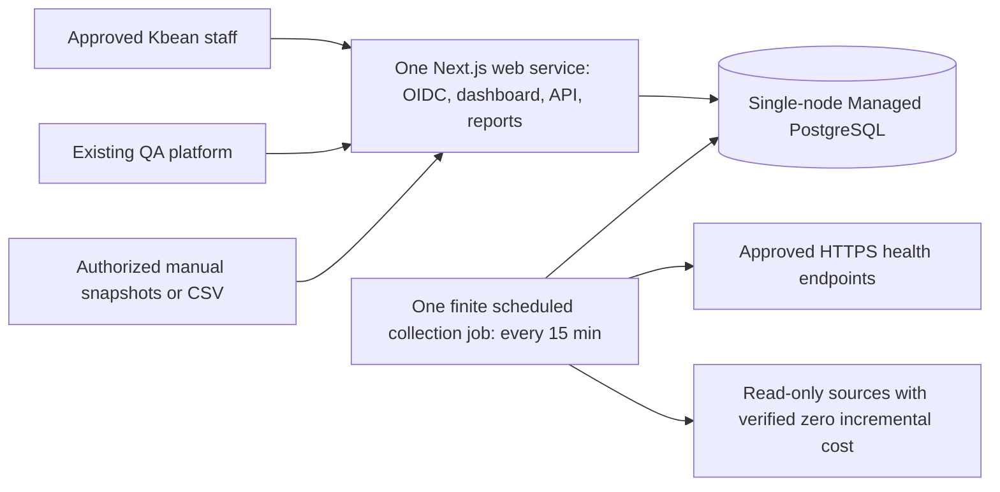

# Lean MVP architecture

Current design revision 2, 31 October 2026. Approved direction: internal monitoring with minimal recurring cost. Local Phase01 and Phase02 implementation are authorized; deployment remains unauthorized.

Only the web service runs continuously. The non-routable job starts, performs bounded work, records results/aggregates and exits. It shares repository modules with the web app; it is not a separate service API or a permanent worker. All status and historical views require staff authentication. The internet-facing ingress for login/QA does not make the app network-private; authorization protects the data.

| Runtime | Responsibilities | Least authority |
| --- | --- | --- |
| Web, initially 1 GiB | OIDC/session/RBAC, inventory, manual imports, small synchronous QA ingestion, incidents/maintenance, reports/CSV | App DB role and OIDC/QA secrets; no collector provider secrets |
| Single-node DB, initially 1 GiB | Users/scope, services/endpoints, observations, daily summaries, integrations/runs, QA/incidents/audits | Separate web, collector and migration principals; TLS |
| Scheduled job, initial budget 1 GiB candidate | Direct HTTPS probes; enabled no-charge adapters; bounded daily aggregation/retention | Collector DB role and only needed provider credentials; no deploy/IAM authority |

TypeScript/pnpm, Next.js/React, Tailwind and Zod remain the baseline. Use shared server modules within the single app for database access, contracts and calculations. Choose a maintained standard Google OIDC library and reviewed SQL/migration tooling during authorized implementation. Pin supported Node LTS/tool versions then; no dependencies are installed in this revision.

No public publication role/schema/cache, external subscriber system, standalone reporting engine, continuously running staging copy, additional monitoring server, hosted AI or paid observability is an MVP dependency. Local PostgreSQL and mocks provide primary testing. A temporary remote environment is possible only when a specific test needs it, with a maximum lifetime, itemized cost and teardown verification.

## Design limits

A 15-minute poll may miss short outages; confirmation across two consecutive failed slots can take about 15–30 minutes plus scheduler delay. Successful collection is not continuous uptime. A single database/web process and same-provider deployment can fail together. The application cannot independently notify staff while its own host or DB is down; manual operational checks and existing provider tools are the initial fallback. These limitations need explicit release acceptance, not extra infrastructure by default.

Infrastructure automation is conditional: permission, known price, shared allowance headroom and bounded queries must all be proven. Manual observations keep their method/source age and cannot turn unknown automatic availability green. Reports compute from stored evidence; no AI conclusions.

The local Phase 01 foundation is implemented in apps/web. Native PostgreSQL 18 hosts isolated development and test databases. The default job exits disabled; the explicit disposable fixture command executes the implemented finite collector. The [Phase 01 report](../reports/phase-01-report.md) distinguishes verified routes from future collection, QA and reporting functions.

## Phase 02 implementation

Shared monitoring modules provide the executor, deterministic state/history calculations, transactionally stored runs/checks/outage events and bounded retention. Migration003 adds monitoring domains to the existing database and a restricted collector identity; it introduces no service or persistent worker. Admin target configuration cannot write owner approvals or observations. Live network execution remains disabled; local HTTP/TLS fixtures use an exact test-only capability and an isolated test database. See [implementation and commands](../operations/availability-monitoring.md). Basic offline-approved maintenance intervals support calculations; full incidents and operational maintenance UI remain Phase04.
