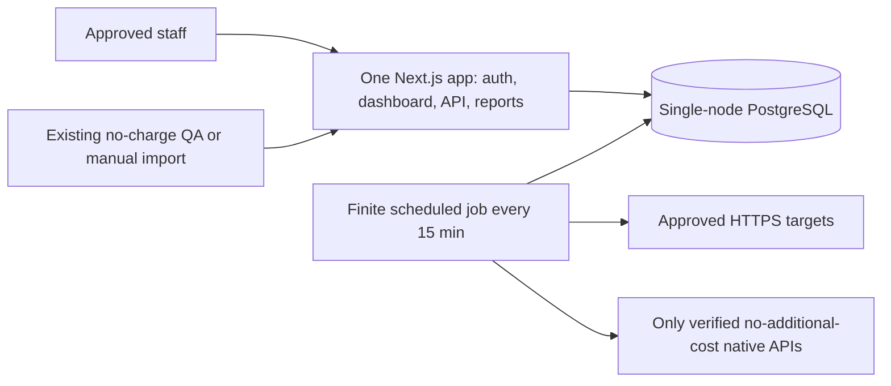

# Revised Phase 00 report: lean internal MVP

31 October 2026 · **Architecture revision delivered for review; Phase 01 not authorized.** The owner's lean direction replaces the expensive/public multi-service proposal. Active docs, schema/API, tests, roadmap and cost controls now describe a private dashboard with one web service, one small database and one finite 15-minute job. Original history is preserved.

## Runtime and product

Seven sections: Overview; Application Status; Infrastructure Health; QA & Security; Incidents & Maintenance; Reports & History; Settings & Integrations. Retain Next.js/React/TypeScript/Tailwind/Zod, standard Google OIDC, server sessions/RBAC and PostgreSQL. Shared server modules serve web and a small job entrypoint; no separate service/package per domain. Local PostgreSQL/mocks are primary testing; temporary DO staging only for a specifically approved gap, budget and lifetime.

Direct HTTPS checks record last check/success, code, latency and observed failures/recovery. History is always labeled **15-minute sampled availability**; short outages can be missed and two-slot failure confirmation may take ~15–30 minutes plus delay. Missing/collector-failed checks are unknown, not successful uptime or confirmed outage. Infrastructure readings display provider/manual method and observation age.

[Architecture](overview.md), [data flow](data-flow.md), [monitoring model](monitoring-model.md), [deployment](deployment.md) and [target layout](repository-structure.md) define execution, trust boundaries and limits.

## Simplified data and APIs

The [schema](../database/schema.md) has 17 justified application tables: ten requested core domains plus membership/session/run/downtime/timeline/maintenance/import support, with an optional migrator-owned metadata table. No partitions, separate time-series engine, public projection, report queue/artifact service or notification outbox. Unique slot/sample/run keys, composite environment references, source/time attribution and bounded retention remain. Proposed raw history is 30d and daily summaries 12m.

The [OpenAPI](../api/openapi.yaml) is a new internal-only proposal: staff-authenticated status/service/metrics/report APIs; safe manual entry/CSV; existing QA intake; scoped settings/incidents/audits. Only minimal platform health and separately authenticated QA bypass staff sessions. Every operation is unimplemented; anonymous public status/publish/subscriber endpoints and models are removed. Reports run inside the app from stored evidence and export CSV; no separate processing infrastructure.

## Integration strategy

| Source | Active MVP policy |
| --- | --- |
| HTTPS targets | Automatic only after owner target/load approval; 15m bounded safe requests |
| DigitalOcean | First native infrastructure integration after metric/scope/cost verification |
| Azure | Manual by default; REST retrieval can be charged, automation requires proof of zero incremental cost |
| GCP | Conditional on actual shared free allowance/headroom and bounded series/page/retry caps |
| Firebase | Existing eligible telemetry only; no new BigQuery export/query/streaming features |
| QA/security | Existing no-charge signed webhook/API or manual import; preserve original reports/references |
| Unknown providers | Disabled until identity/interface/price/permissions established |

All live sources start disabled; zero monitored targets and zero account allowances are verified today. [Matrix](../integrations/feasibility-matrix.md), [manual contract](../integrations/manual-imports.md) and [research](research.md). A manual import is a staff assertion with actor/source/observation time, never impersonated provider evidence or automatic availability.

## Security and tests retained

[Threat model](../security/threat-model.md) and [access policy](../security/access-control.md) retain OIDC allowlist/MFA, server role/env checks, CSRF/secure sessions, job-only provider credentials, TLS/read-only grants, actual-executor SSRF protections, input/rate/body limits, QA signatures/replay, safe CSV and audit. Independent offline architecture review was incorporated; no runtime security finding or implemented control is claimed.

[Test strategy](../testing/test-strategy.md) proposes five concurrent staff, 20 endpoints and <=100 infrastructure series. Local unit/DB/API/provider contract/Playwright/security/load tests remain required. Job target <=120s normal, <=300s hard process deadline, <=40 probe attempts/run. Missing/cost-disabled data stays visible. Managed restore must be separately approved/budgeted and demonstrated before release; proposed recovery objectives are <=24h RPO and <=1 business day RTO, not guarantees.

## Budget and remaining exposure

Published starting base: **$12 web + $15 database = $27/month before tax**. Reserve $5 for finite-job runtime and $3 for small variable/temporary-test costs: **$35 pre-tax/FX planning envelope**. Target remains approximately **€50/month**, subject to actual account billing and an agreed spending limit.

At 2,976 runs in a 31-day month, modeled 1/2/5-minute runs cost approximately $0.89/$1.77/$4.43 using the documented size price/proration assumptions. Exact job eligibility/minimum/startup/retry billing must be confirmed; the general app-creation $0.01 minimum is not established as a per-invocation fee. If it applied per start, job cost alone would be $29.76 and invalidate the allowance. The [itemized cost model](../deployment/cost-estimate.md) states this sensitivity, tax/FX arithmetic, overage/test costs and upgrade limits.

The €50 target is **not a guaranteed billing cap**. Shared provider allowances, delayed invoices, unexpected retries, transfer/storage and temporary resources can exceed estimates; unknown-cost integrations stay disabled. A 2 GiB app upgrade requires approval. No paid API/AI/logging/analytics/notification features are included.

## Roadmap, changes and history

Foundation → HTTPS availability → DO/free/manual infrastructure → existing QA/incidents/reports → full verification and explicitly authorized release. Targets remain 18 Dec 2026, 29 Jan, 19 Feb, 12 Mar and 31 Mar 2027, conditional on gate completion. [PLANS](../../PLANS.md), [backlog](../../harness/build/backlog.md), [detailed Phase 01](../../harness/build/phase-01.md).

[Change comparison and deferred features](change-summary.md) list every removed runtime: persistent collector, monitoring stack/hosts, HA standby, permanent remote staging, secondary region, queues/microservices, public publishing/subscribers, separate report/archival services and paid features. They are not hidden requirements. [ADR 0007](../decisions/0007-lean-internal-mvp.md) supersedes the earlier ADRs; [v1 snapshot](../archive/phase-00-v1/HISTORICAL.md) preserves 52 original files with hashes.

## Deliverable checklist and next gate

All fourteen requested packet elements are covered: diagram, simple runtime/layout, feature scope, schema, API, zero-additional-paid-API policy, security, tests, cost estimate, minimum-useful roadmap, deferred list, change comparison, Phase 01 plan and [outstanding decisions](../../harness/context/decisions-and-open-questions.md). [Validation report](../testing/phase-00-validation.md) and [build log](../../harness/build-log.md) record actual checks; runtime tests remain unexecuted.

Before Phase 01: verify initial inventory and IdP/MFA; resolve account job/hosting pricing and currency/tax/limit; approve sampling/workload/retention/recovery; record the exact reviewed revision and explicit local implementation authority. Optional costly/uncertain providers may stay manual/disabled. Before any remote test/release, separately approve exact resources, budget/lifetime, cleanup and deployment action. No resources, integrations, databases, dependencies, application code, commits or pushes were created by this revision.
