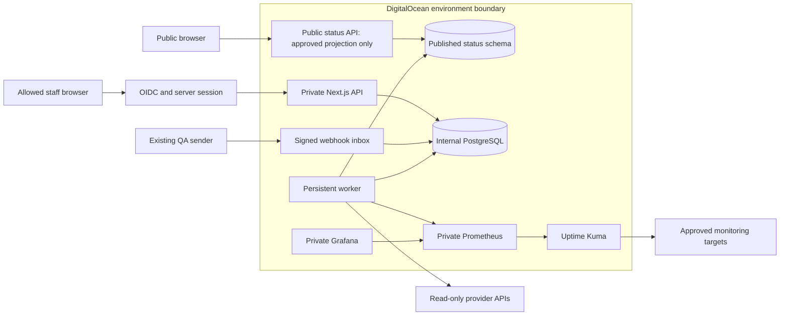

# Logical architecture

Status: proposed v1, 31 October 2026. The only pre-existing files were README, LICENSE and .gitignore; all runtime behavior below is a design.

## Components and trust zones

Use one modular Next.js application for public/private routes and a separate worker process. Common code is a convenience, not a security boundary: public routes use a distinct database role and explicitly projected schemas, private routes authorize every access, and the worker alone holds cloud credentials. A web-process compromise could still access its private DB role; independent public hosting is a later resilience/security improvement, not an initial guarantee.

| Component | Owns | Must not own |
| --- | --- | --- |
| Web/API | OIDC sessions, RBAC, inventory/incident management, validated webhook inbox, status reads | Cloud credential values or arbitrary cloud proxy endpoints |
| Worker | Scheduling, adapters, normalization, aggregation, alert evaluation, approved publication and reports | Infrastructure remediation or new permissions |
| PostgreSQL | Durable inventory/configuration, samples/rollups, jobs, incidents/QA/audits | Unlimited raw logs or provider secrets |
| Kuma | Approved probe execution and TLS checks | Kbean publication authority or infrastructure management |
| Prometheus | Bounded high-frequency series | Permanent business record or authoritative incident workflow |
| Grafana | Private engineering diagnosis | Public status publication |
| Spaces | Optional private encrypted report/recovery archives | Public sensitive export URLs |

## Stack proposal

TypeScript, pnpm workspaces, Next.js App Router/React, Tailwind, accessible components and Zod follow the baseline. Use PostgreSQL with typed SQL access (propose Drizzle plus reviewed SQL migrations); test partitioning/pooling compatibility in Phase 01 before adoption. Use an established OIDC/session library, selected through a security/maintenance check, rather than custom OAuth crypto. Vitest, Playwright, k6, secret/dependency scanning and ZAP cover distinct verification layers.

Prefer a supported Node LTS supported by both App Platform and adapters; Node 24 LTS is a conservative candidate. Lock exact versions and image digests only after a Phase 01 compatibility/security check. [Node lifecycle](https://nodejs.org/en/about/previous-releases) and [Next.js requirements](https://nextjs.org/docs/app/getting-started/installation) were reviewed; no packages are installed here.

Use PostgreSQL jobs with leases/idempotency instead of a second queue service; evaluate an existing PostgreSQL queue library against the [scheduler contract](data-flow.md) before choosing a custom implementation. Do not add microservices, Redis, Kafka or Kubernetes without measurable need.

## Contradictions resolved as proposals

1. Six health labels combine service condition and evidence quality: persist two axes; render Unknown/Stale as quality badges, never false success.
2. Kuma gauges expose current samples, not a guaranteed immutable per-probe event log. History is explicitly sampled availability; prove freshness of the underlying probe before allowing Healthy. Exact check reconstruction is an unresolved Phase 03 gate.
3. Read-only monitoring can still issue chargeable BigQuery query jobs. Their scoped query permission and budget require a separately reviewed exception; no monitored data or configuration may be written.
4. “All data on DO” means Health System storage/execution. Existing provider telemetry and Firebase BigQuery exports remain source systems; confirm this interpretation before enabling BigQuery.
5. Public subscriptions introduce personal data if email addresses are stored. Prefer an approved feed initially, or separately approve consent, unsubscribe, retention and delivery integration.
6. Manual approved monitor configuration is required unless Kuma publishes a supported stable administration interface. Do not silently automate its internal Socket.IO API.
