# Database schema proposal and ERD

Design only; no migrations executed. Managed PostgreSQL version must be supported by DO at provisioning. Use UUID primary keys, UTC timestamptz, explicit NOT NULL/default/check constraints and parameterized SQL. JSONB is restricted to validated metadata/dimensions, never credentials or entire provider responses.

## Relationships

```mermaid
erDiagram
  users ||--o{ memberships : has
  roles ||--o{ memberships : grants
  users ||--o{ sessions : authenticates
  products ||--o{ assets : includes
  environments ||--o{ assets : isolates
  assets ||--o{ dependencies : requires
  assets ||--o{ monitored_endpoints : checks
  provider_accounts ||--o{ integrations : authorizes
  integrations ||--o{ integration_capabilities : advertises
  integrations ||--o{ sync_runs : attempts
  integrations ||--o{ metric_series : supplies
  assets ||--o{ metric_series : measures
  metric_definitions ||--o{ metric_series : defines
  metric_series ||--o{ metric_snapshots : records
  metric_series ||--o{ metric_hourly_rollups : summarizes
  metric_series ||--o{ metric_daily_rollups : summarizes
  assets ||--o{ health_states : current
  assets ||--o{ status_transitions : changes
  assets ||--o{ monitor_coverage : covers
  incidents ||--o{ incident_updates : narrates
  incidents ||--o{ affected_assets : impacts
  assets ||--o{ affected_assets : affected
  maintenance_windows ||--o{ maintenance_assets : schedules
  assets ||--o{ maintenance_assets : covered
  incidents ||--o{ public_revisions : proposes
  public_components ||--o{ public_component_mappings : maps
  assets ||--o{ public_component_mappings : contributes
  public_revisions ||--o{ publication_audits : approves
  alert_rules ||--o{ alert_events : evaluates
  alert_events ||--o{ acknowledgements : acknowledged
  alert_events ||--o{ notification_deliveries : notifies
  integrations ||--o{ webhook_events : receives
  integrations ||--o{ qa_test_runs : imports
  qa_test_runs ||--|| qa_run_summaries : summarizes
  qa_test_runs ||--o{ qa_evidence_references : references
  report_definitions ||--o{ report_runs : generates
  report_runs ||--o{ report_artifacts : exports
  integrations ||--o{ background_jobs : schedules
  integrations ||--o{ integration_errors : fails
  users ||--o{ audit_events : acts
```

## Entity definitions

Every environment-bound child carries environment_id and uses composite foreign keys where necessary to prevent cross-environment links. Products may span environments; assets and integrations cannot. Internal identifiers never become public identifiers automatically.

| Domain/table | Key fields and constraints |
| --- | --- |
| users | id; issuer+subject unique; display email; approved/disabled timestamps; no password |
| roles / memberships | role slug unique; membership user+role+product+environment unique with explicit global-scope representation; publisher as separate capability grant |
| sessions | unique token_hash; user_id; issued/last_seen/absolute_expires/revoked_at; no raw token |
| products / environments | unique product slug and environment name; environment enum production/staging/development |
| assets | product/env/provider_account; resource_type, external_id, region, owner, criticality; verification/evidence/approval timestamps; unique provider_account+env+external_id |
| dependencies | asset+depends_on composite key, required/optional, impact policy; same env; reject cycles in transactional application validation |
| monitored_endpoints | asset/env; private URL reference, protocol/ports, interval, approved_by/at, monitor identity, disabled_at; unique engine+monitor_id+env |
| provider_accounts | provider slug, external account reference, environment, owner; no secrets |
| integrations | account/env, adapter/version, secret_reference, approved_scope_version, enabled, next_due_at; never store secret values |
| integration_capabilities | integration+metric/capability unique; state, unit, allowed dimensions, lag, interval, quota/cost budget |
| sync_runs / integration_errors | integration, scheduled/start/end, outcome, attempts, counts, safe code/request ID, source watermark; bounded sanitized context |
| metric_definitions | provider+name+definition_version unique; kind, canonical unit, permitted aggregation, freshness policy |
| metric_series | integration/asset/env/definition, dimension_hash, validated dimensions; unique tuple, capped cardinality |
| metric_snapshots | series, observed_at, interval_start/end, collected_at, ingested_at, nullable finite value, quality, aggregation, source_revision; unique series+observed_at+interval_start+aggregation (includes partition key) |
| metric_hourly_rollups / metric_daily_rollups | series+bucket_start+calculation_version unique; min/max/sum/count, known/unknown/maintenance seconds, source watermark and correction revision |
| health_states | asset+capability unique; condition, quality, source time, evaluated time, evidence reference/version; condition and freshness separate |
| status_transitions / monitor_coverage | asset/monitor, start/end, condition, observation provenance; nonnegative half-open durations, reject overlapping finalized intervals per monitor |
| incidents / incident_updates / affected_assets | internal ID, title, severity, lifecycle, owner, env, start/resolved timestamps, optimistic version; append-only timeline, same-env affected assets |
| maintenance_windows / maintenance_assets | start < end, approval, internal description, env, affected assets; merge overlapping approved windows for calculations |
| public_components / mappings | opaque public UUID, approved name/order/enabled; private mapping to asset/env is in internal schema; only approved production components initially |
| public_revisions / publication_audits | public ID, sanitized text/status/times, public component IDs, revision/digest, preview/approved/published/retracted times and actors; unique public ID+revision; linkage to internal incident stays private |
| alert_rules / alert_events | env/assets, metric/predicate/version, hold/recover/cooldown, owner/authority; one unresolved event per rule+asset+dimension hash |
| acknowledgements / silences | alert, user, timestamp/comment; silence requires expires_at and reason; append audit |
| notification_deliveries | alert/report/publication event version, destination reference, channel, status/attempts/next_retry/provider receipt; dedupe key unique; no raw destination secrets |
| webhook_events | integration+event_id unique; body digest, key ID, received time, processing state; normalized minimum payload, no signature secret |
| qa_test_runs / summaries | integration+source_run_id unique; asset/env, suite, start/end/duration, terminal state, optional deployment/version; counts >=0, flaky subset, completion>=start |
| qa_evidence_references | run, allowed HTTPS URL, audience/classification; no automatic content fetch |
| report_definitions / runs / artifacts | schedule/scope, requested period, immutable snapshot version, coverage, status; artifact format/object key/hash/size/expiry; same env as definition |
| external_finding_references | source+external ID+env unique, asset, severity, title, authorized URL, last seen; no raw vulnerability payload |
| audit_events | actor/service, action, target, env, time, request ID, sanitized before/after diff hash; append-only runtime permissions; archive for tamper resistance |
| background_jobs | kind/integration/env/scheduled_for/idempotency key unique; state, attempts, run_after, lease_until, owner, fencing token; validated bounded payload |
| system_configuration | env+key unique; typed value, version, owner, approval; no secret values |
| mutation_requests / outbox | actor+route+idempotency key unique, request digest/result reference/expiry; outbox event ID unique with transactional creation |

## Index and capacity plan

B-tree on assets `(environment_id,product_id)`, incidents `(environment_id,status,started_at DESC,id)`, sync runs `(integration_id,started_at DESC)`, QA `(environment_id,asset_id,completed_at DESC,id)`, audit `(environment_id,occurred_at DESC,id)` and series `(asset_id,metric_definition_id)`. Snapshots use `(series_id,observed_at DESC)` and time pruning; rollups use `(series_id,bucket_start)`. Jobs have partial indexes on due pending/retry rows and expired leases. Alert unresolved uniqueness is a partial index, not only application logic. Avoid broad GIN indexes on every JSONB column.

Sizing example (assumptions, not inventory): 100 assets × 20 series × 288 five-minute intervals = 576,000 snapshots/day; 30 days = 17.28m rows. At an assumed 300 bytes/row including indexes, ~5.18 GB before WAL, bloat and backup overhead. Prometheus probe series are not copied wholesale into PostgreSQL; store bounded observations/intervals and rollups. Benchmark row size/cardinality and reserve >=2× measured headroom before choosing storage.

Propose daily time partitions for snapshots and monthly for large audit tables, introduced when actual volume warrants it. PostgreSQL unique constraints on partitioned tables must include the partition key; do not assume a global unique index across time partitions. Keep run/event idempotency in nonpartitioned ledgers and include observed_at in sample uniqueness. [Partitioning reference](https://www.postgresql.org/docs/current/ddl-partitioning.html). Reject corrections older than retained raw horizon or apply a deliberate aggregate correction workflow with audit.

## Retention and migrations

Detailed samples/Prometheus 30d; hourly aggregates 90d; daily aggregates at least 12m; public daily history >=90d; incidents/QA/reports 12m proposed; audit 12m proposed; webhook event IDs 90d plus run uniqueness for run lifetime; completed jobs 30d and failures 90d. Policies need owner approval. Aggregate and reconcile coverage before deleting raw data; never drop a partition whose rollup watermark is incomplete. Holds suspend approved deletion for relevant records.

Forward-only versioned, reviewed SQL migrations use expand/backfill/contract. Separate migration credential, advisory migration lock, bounded lock timeout and compatible app releases. Rehearse upgrade from previous schema on fixture-sized data and restore to an isolated database. No uncontrolled destructive down-migration. Size PgBouncer and per-process pools against the actual plan's connection limit; budget web replicas+worker+jobs+admin reserve. Lease fencing must survive transaction pooling (no assumed persistent session lock).

Public SELECT-only role reads only a separate sanitized publication schema; publication writer uses a narrow transaction/function and audit. Private mapping tables stay inaccessible. All internal API queries bind membership scope and environment. PostgreSQL RBAC and constraints supplement server authorization; RLS may be added only with an ADR/testing plan rather than claimed by default.
