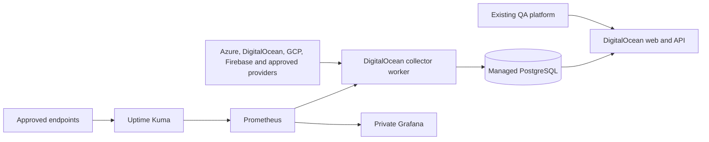

# Kbean Health System — Master Architecture & Codex Development Blueprint

Architecture v1.0 • 31 October 2026

Project: Kbean Centralized Health Monitoring System Target completion: 31 March 2027 Source control: Private GitHub repository Hosting and database: DigitalOcean Development: Codex, using phased implementation and mandatory testing

The goal is to build a centralized operations platform that allows Kbean to monitor the availability, performance, infrastructure health, security indicators, incidents, and QA results of its products from one place.

This architecture carries forward our earlier decisions, including the public status page modeled on [XPR Network Status](https://status.xprnetwork.org/?utm_source=chatgpt.com), the authenticated health dashboard, automated metrics collection, historical reporting, and integration with our existing QA system.

## 1. Recommended deployment architecture

I recommend separating the web application, database, and monitoring engines while keeping all Health System hosting and database infrastructure on DigitalOcean.

### Kbean Health — System Architecture

> Editorial note: reconstructed the logical diagram from its exported text labels; removed the malformed Mermaid CSS. All prose requirements below are retained.

All monitoring data, application code execution, and platform databases are hosted on DigitalOcean. Other providers remain the monitored data sources.

### DigitalOcean services

| Service                 | Responsibility                                                                             |
| ----------------------- | ------------------------------------------------------------------------------------------ |
| App Platform            | Host the Next.js web application, backend services, and scheduled workers                  |
| Managed PostgreSQL      | Store assets, incidents, normalized metrics, reports, user roles, and historical summaries |
| Dedicated Droplet       | Run Uptime Kuma, Prometheus, and Grafana in containers                                     |
| VPC networking          | Connect application components to the database and monitoring services privately           |
| Spaces                  | Optional encrypted long-term backups and report archives                                   |
| DigitalOcean Monitoring | Monitor the infrastructure hosting the Health System itself                                |

This setup is supported by DigitalOcean's documented application, worker, private networking, and managed database capabilities.&#x20;

[image](https://www.google.com/s2/favicons?domain=https://docs.digitalocean.com\&sz=32)

DigitalOcean Documentation

+3

I recommend this arrangement over putting absolutely everything on one Droplet. A single VM is cheaper, but it creates an unnecessary single point of failure for a platform intended to monitor other failures.

The public status page should eventually have an independent monitoring path, preferably using another DigitalOcean region. A full DigitalOcean provider outage would still be a shared risk, which we should document rather than pretend we can eliminate.

One other architectural requirement is important: do not make Codex depend on Uptime Kuma's undocumented internal API. Uptime Kuma supports a Prometheus metrics endpoint, while its internal application API is explicitly not guaranteed stable for external integrations.&#x20;

[image](https://www.google.com/s2/favicons?domain=https://github.com\&sz=32)

GitHub

+1

The remaining sections form the implementation specification that Codex should use to plan the project.

## 2. Important technical decisions before development

Two details affect how Codex should implement the architecture.

First, DigitalOcean App Platform's scheduled cron jobs have a minimum interval of 15 minutes. Because we want some infrastructure metrics every five minutes, those collectors should run in a persistent worker with a database-backed scheduler. Uptime Kuma will handle its own shorter availability checks.&#x20;

[image](https://www.google.com/s2/favicons?domain=https://docs.digitalocean.com\&sz=32)

DigitalOcean Documentation

Second, data freshness differs across providers. For example, Firebase Crashlytics has daily BigQuery exports and an optional streaming mode, so we cannot assume every Firebase metric will be immediately available.&#x20;

[image](https://www.google.com/s2/favicons?domain=https://firebase.google.com\&sz=32)

Firebase

For Codex, `AGENTS.md` should be the primary persistent instruction file. We should keep it concise and put the extensive requirements in dedicated documents. Codex recognizes `AGENTS.md` automatically; `GOALS.md`, `PLANS.md`, and the other planning documents will provide the detailed project context.&#x20;

[image](https://www.google.com/s2/favicons?domain=https://developers.openai.com\&sz=32)

OpenAI Developers

## 3. Complete architecture specification for Codex

The following is the master brief. It combines the project requirements, system design, database architecture, cloud integration strategy, AI files, delivery milestones, and the instructions Codex should follow when planning the repository.

# KBEAN HEALTH SYSTEM

## Master Architecture, Requirements & Codex Planning Specification

**Document version:** 1.0\
**Date:** 31 October 2026\
**Project status:** Planning and architecture\
**Project period:** 30 October 2026 – 31 March 2027\
**Repository:** `kbean-health-system` (proposed private GitHub repository)\
**Infrastructure provider:** DigitalOcean\
**Implementation agent:** OpenAI Codex

---

# 1. Project Overview

## 1.1 Purpose

Build a centralized, secure, web-based health monitoring platform for Kbean and its INSSA ecosystem.

The platform will provide visibility into application uptime, infrastructure performance, operational issues, service reliability, incidents, automated QA test results, and security monitoring indicators.

It must consolidate information that is currently distributed across Azure, DigitalOcean, Firebase, Google Cloud, and existing internal tools.

The objective is to allow authorized Kbean team members to log in and quickly determine:

- Which Kbean products and services are operational.
- Which infrastructure resources are healthy or degraded.
- Whether applications or APIs are experiencing downtime.
- Whether infrastructure utilization is approaching unhealthy levels.
- Whether recent QA tests have passed or failed.
- Whether active incidents or security findings require attention.
- How the system has performed over the previous 24 hours, 7 days, 30 days, and 90 days.
- When the underlying metrics were collected and whether they remain reliable.

The platform must reduce manual infrastructure checks and support operational decision-making through trustworthy, automated information.

## 1.2 Core Design Principles

1. **Centralized visibility:** One dashboard for infrastructure, availability, QA results, incidents, and operational health.
2. **Read-only infrastructure integrations:** Monitoring must not modify Kbean production resources.
3. **Automated collection:** Collect metrics using authenticated provider APIs and scheduled tasks.
4. **Accurate reporting:** Never display sample, missing, outdated, or unverified information as live system health.
5. **Security by design:** Apply least privilege, strong authentication, auditability, and secure credential storage.
6. **Modular architecture:** Add cloud integrations without redesigning the application.
7. **Low maintenance:** Reuse proven monitoring engines instead of rebuilding their functionality.
8. **Cost efficiency:** Avoid unnecessary infrastructure, services, and high-frequency provider queries.
9. **Production safety:** Implement and validate in staging before connecting or releasing production monitoring.
10. **Documentation first:** Maintain architecture, API specifications, decisions, test evidence, and operational procedures throughout development.

## 1.3 Non-Goals for Version 1

The initial version will not:

- Replace the existing Kbean QA platform.
- Replace Wazuh, Eramba, or other existing security/GRC systems.
- Migrate Azure, Firebase, or GCP workloads to DigitalOcean.
- Automatically restart, deploy, scale, or reconfigure production infrastructure.
- Modify cloud IAM permissions, security rules, alert policies, databases, or application data.
- Collect customer personal information or production business records unnecessarily.
- Build a custom time-series engine, SIEM, or distributed tracing platform.
- Include AI-generated incident conclusions presented as verified facts.

The Health System is initially an observability, monitoring, reporting, and incident coordination platform.

---

# 2. Functional Architecture

The product has three main functional areas.

## 2.1 Public Status Page

Create a public status page inspired by [https://status.xprnetwork.org/](https://status.xprnetwork.org/).

It will provide an accessible, branded interface showing the operational status of approved Kbean services.

Initial service candidates:

- INSSA Studio.
- INSSA Discovery — `inssa.us`.
- INSSA Life.
- Other approved Kbean web applications, APIs, and customer-facing services.

The monitored components must be defined by an approved asset inventory before configuration.

Required features:

- Current overall system status.
- Individual application/component status.
- Operational, Degraded, Partial Outage, Major Outage, and Maintenance indicators.
- Uptime percentage for supported periods.
- Visual 90-day uptime history.
- Active incident information.
- Resolved incident history.
- Scheduled maintenance notices.
- Incident start, investigation, update, monitoring, and resolution timelines.
- Publicly approved incident subscriptions or notification channels.
- Responsive presentation for desktop and mobile.

The public status page must not expose internal infrastructure names, private endpoints, cloud subscription identifiers, security vulnerabilities, credentials, diagnostic logs, or sensitive internal incidents.

Use Uptime Kuma for monitoring execution, Prometheus for supported time-series collection, and the Kbean application database for approved incident/status publication.

Avoid dependence on undocumented Uptime Kuma administrative APIs.

## 2.2 Private Infrastructure Health Dashboard

Build an authenticated internal application showing operational health across cloud providers.

Required areas:

**Overview:** Current platform health, affected services, active incidents, freshness indicators, and priority issues.

**Applications:** Health status for individual Kbean/INSSA products, with production and staging separated.

**Infrastructure:** Provider-specific metrics, resource-level health, capacity, errors, historical charts, and collection status.

**Availability:** Website, API, SSL, endpoint, and service availability monitoring.

**Incidents:** Internal incident management, status, severity, service impact, timeline, evidence references, ownership, and resolution.

**QA & Security:** Latest automated QA results, failed tests, monitoring warnings, and links to supported security findings.

**History & Reports:** Daily, weekly, monthly, and historical health summaries.

**Integrations:** Provider connection status, permission checks, failed synchronization attempts, last successful collection, and supported metric inventory.

**Administration:** User roles, configured monitors, notification rules, thresholds, maintenance windows, and audit records.

The user interface must be compact, professional, responsive, and designed to show operational priorities without unnecessary visual clutter.

## 2.3 Existing QA Platform Integration

The Health System will not execute or duplicate Kbean's automated QA platform.

Instead, design a versioned integration contract to retrieve or receive:

- Test suite name.
- Application and environment.
- Test run identifier.
- Execution timestamp and duration.
- Passed, failed, skipped, and flaky test counts.
- Failed test summaries.
- Test status and completion state.
- Evidence and report links where authorized.
- Associated application version or deployment identifier, when available.

Preferred integration methods:

1. Authenticated, signed webhook on test completion.
2. Read-only QA API polling if webhooks are unavailable.

QA records must be idempotent, validated, and traceable to their original source.

Security findings may be linked to the relevant asset or service. Do not reproduce an entire vulnerability-management or SIEM system.

---

# 3. Infrastructure and Provider Inventory

Phase 00 must establish a verified inventory before enabling production integrations.

## 3.1 Initial Inventory Candidates

**Application layer**

- INSSA Studio.
- INSSA Discovery.
- INSSA Life, including supported web/API and TV service dependencies.
- Kbean/KBM application and backend services.
- Approved admin dashboards and other operational applications.

**Azure**

- Azure-hosted APIs and application services.
- Cosmos DB resources, including the production account currently used by Kbean.
- Azure Monitor metrics and relevant diagnostic indicators.
- Database throughput, failures, availability, and request performance.

**DigitalOcean**

- Existing Kbean Droplets.
- Approved App Platform applications.
- Relevant storage, databases, networking, and service-monitoring resources.
- Existing Eramba and Wazuh infrastructure where appropriate.
- The new Health System's hosting resources.

**Firebase**

- Staging project (identifier withheld).
- Production project (identifier withheld).
- Cloud Functions.
- Authentication operational metrics where available.
- Cloud Storage usage and performance.
- Firestore monitoring metrics.
- Crashlytics and application reliability data where permission and export configuration support it.
- App Check monitoring/configuration indicators where available.

**Google Cloud**

- GCP CDN/media-delivery infrastructure.
- Relevant storage, request, error, bandwidth, and latency metrics.
- Cloud Monitoring resources associated with approved Kbean infrastructure.

**Other systems**

- Hashio.
- Fusion.
- Additional infrastructure services identified during discovery.

The exact identities, monitoring interfaces, and supported metrics for Hashio and Fusion must be established rather than assumed.

## 3.2 Required Asset Metadata

Every monitored asset must have:

- Unique asset identifier.
- Product/application association.
- Cloud provider.
- Resource type and verified resource identifier.
- Environment: production, staging, or development.
- Region, where applicable.
- Service owner.
- Business criticality.
- Parent/dependent components.
- Supported monitoring endpoints.
- Metric definitions.
- Collection interval.
- Approved authentication method.
- Status and alert thresholds.
- Last successful synchronization.
- Monitoring coverage and known limitations.

Production and staging must remain clearly separated throughout the database, monitoring policies, reporting, and interface.

---

# 4. System Architecture

## 4.1 Web Application

**Recommended stack**

- Next.js with React and TypeScript.
- Tailwind CSS.
- Accessible reusable UI components.
- Zod for runtime input validation.
- REST APIs documented using OpenAPI.
- DigitalOcean App Platform for deployment.

Use a modular monolith for the initial application rather than splitting all functionality into separate microservices.

The public status interface and internal dashboard may share application code and design components, but they must have separate authorization boundaries and data-access policies.

Browser clients must never communicate directly with infrastructure providers using privileged cloud credentials.

## 4.2 Background Collection Services

Implement a dedicated background worker service.

Responsibilities:

- Schedule provider collection tasks.
- Retrieve authorized metrics.
- Validate payloads.
- Normalize units and labels.
- Persist readings and synchronization status.
- Calculate historical aggregates.
- Detect threshold breaches.
- Evaluate alert transitions.
- Generate reports.
- Process incoming QA events.

Use PostgreSQL-backed scheduling/job coordination with idempotent tasks and safe concurrency.

Do not rely exclusively on App Platform cron for five-minute collection intervals.

Add bounded retries, exponential backoff, jitter, API quota limits, per-provider timeouts, and collection circuit breakers.

A failing provider should not block other integrations.

## 4.3 Database

Use DigitalOcean Managed PostgreSQL.

PostgreSQL is the source of truth for:

- Asset inventory.
- User roles and configuration.
- Connector definitions and credential references.
- Normalized snapshots and rollups.
- Current status and freshness.
- Incident records.
- Alert policies and alert events.
- QA summaries.
- Report metadata.
- Audit trails.

Use version-controlled database migrations and documented constraints.

Prefer relational tables for core data, with JSONB used only for validated provider-specific metadata that does not justify dedicated columns.

Do not store unrestricted provider API responses indefinitely.

## 4.4 Observability Components

**Uptime Kuma**

- Perform approved website/API health checks.
- Monitor TLS certificate validity and expiry.
- Track supported HTTP/TCP/DNS checks.
- Supply availability and response-time metrics.

**Prometheus**

- Collect supported time-series output from Uptime Kuma and approved exporters.
- Store detailed monitoring history with bounded retention.
- Support monitoring history and trend queries.

**Grafana**

- Provide detailed engineer-level metrics dashboards.
- Support troubleshooting and provider-specific diagnostic views.
- Remain private and protected by authentication.

The custom Kbean interface should contain the primary operational summaries. Grafana is used for deeper engineering analysis.

## 4.5 Caching and Storage Boundaries

Use the following storage model:

- Prometheus: supported high-frequency probe and infrastructure time series.
- PostgreSQL: normalized snapshots, aggregate history, current status, incidents, QA summaries, and reports.
- Worker/database-backed cache: most recently successful provider readings and freshness metadata.
- DigitalOcean Spaces: optional encrypted archival of reports and approved backup exports.

Do not introduce Redis, Kafka, Kubernetes, Elasticsearch, or another distributed infrastructure layer without a demonstrated requirement.

---

# 5. Provider Integration Strategy

Create a common integration interface implemented by provider-specific adapters.

Every adapter must support:

- Connection validation.
- Credential permission verification.
- Asset/resource discovery where authorized.
- Supported metric discovery.
- Read-only data collection.
- Unit normalization.
- Sync status reporting.
- Rate-limit handling.
- Retry behavior.
- Safe error logging.
- Integration-specific contract tests.

## 5.1 Azure

Use Azure Monitor APIs with a narrowly scoped, read-only identity.

Priority metrics:

- Cosmos DB normalized RU consumption.
- Request volume.
- HTTP 429 throttling.
- Request failures.
- Availability where reported.
- Latency where available.
- Throughput and capacity trends.
- Relevant application and API metrics.

Do not interpret high normalized RU consumption alone as proof of downtime.

Support resource-level and collection-level breakdowns only where API dimensions and permissions allow them.

## 5.2 DigitalOcean

Use appropriately scoped, read-only DigitalOcean API credentials.

Priority metrics:

- Droplet CPU.
- Available and used memory.
- Disk usage and filesystem capacity.
- Load averages.
- Bandwidth/network usage.
- Available application metrics.
- Supported database health metrics.
- Infrastructure monitor collection status.

Enable metrics agents only through a separately approved infrastructure-change process.

## 5.3 Google Cloud

Use Cloud Monitoring APIs with minimum necessary read access.

Priority metrics:

- CDN requests and error rates.
- Storage usage.
- Bandwidth.
- Available service latency.
- Relevant resource availability and infrastructure performance.

Do not claim that unavailable or uninstrumented metrics exist.

## 5.4 Firebase

Use supported Google Cloud Monitoring and Firebase data-access mechanisms.

Priority metrics:

- Cloud Functions invocation and failure trends.
- Relevant service availability and execution errors.
- Supported Firestore/Storage monitoring metrics.
- Available Authentication operational metrics.
- Crashlytics application stability indicators.
- Supported App Check monitoring indicators.

Crashlytics export integration requires verification of BigQuery availability, billing implications, permissions, and export latency.

**Do not reuse privileged Firebase Admin SDK credentials to build monitoring integrations.**

All access should use purpose-specific read-only permissions. Existing staging and production monitoring configuration must remain unchanged unless separately authorized.

## 5.5 QA and Security

Use authenticated webhook ingestion or read-only API collection.

Support external references to:

- Existing QA test reports.
- Test artifacts.
- Wazuh security findings.
- Relevant vulnerability scans.
- Incident records in existing security/GRC systems.

Do not duplicate security datasets or ingest unnecessary sensitive logs.

## 5.6 Additional Providers

Implement Hashio, Fusion, and any new provider only after confirming:

- Product identity.
- API documentation.
- Available monitoring endpoints.
- Authentication method.
- Required permissions.
- Metric availability.
- Expected cost and rate limits.

---

# 6. Monitoring Frequency and Health Calculation

## 6.1 Proposed Collection Schedule

| Data source                  | Initial target frequency                |
| ---------------------------- | --------------------------------------- |
| Critical website/API probes  | 60 seconds                              |
| Azure Cosmos DB              | 5 minutes                               |
| DigitalOcean infrastructure  | 5 minutes                               |
| GCP resource metrics         | 5–15 minutes                            |
| Firebase operational metrics | 15–60 minutes, if supported             |
| Firebase Crashlytics exports | Source-dependent, often daily           |
| QA results                   | On test completion or scheduled polling |
| TLS certificate checks       | Daily                                   |
| Daily operational summary    | Every 24 hours                          |

These intervals are configurable defaults. Codex must verify source limits, rate limits, API costs, and data latency before implementation.

## 6.2 Health State Model

Define these operational states:

- **Healthy:** Confirmed operational and within approved thresholds.
- **Degraded:** Operational but experiencing performance or reliability problems.
- **Down:** An outage has been confirmed through defined checks or evidence.
- **Maintenance:** Approved scheduled maintenance is active.
- **Unknown:** Insufficient evidence to determine current health.
- **Stale:** The latest collection is older than the accepted freshness threshold.

Distinguish monitoring-data quality from the health of the underlying service. A failed collector does not necessarily mean the monitored service is down.

## 6.3 Availability Calculation

Store timestamped check results and status transitions.

Calculate uptime over explicit time windows.

Define:

- Successful observation intervals.
- Failed observation intervals.
- Unknown or missing observation intervals.
- Maintenance intervals.
- Coverage percentage.

Uptime percentages must account transparently for missing measurements. An unknown interval must not be silently counted as successful uptime.

Document whether planned maintenance counts toward the published availability target.

Include the calculation method and data coverage in reports.

## 6.4 Historical Retention Proposal

- Detailed monitoring samples: initially 30 days.
- Public status history: rolling 90 days.
- Daily infrastructure summaries: at least 12 months.
- Incident records: retained according to approved operational policy.
- Security/audit logs: separate security-approved retention policy.

Build a retention and aggregation strategy that prevents uncontrolled database growth.

---

# 7. Database Domain Model

Prepare an entity relationship diagram and version-controlled schema proposal.

Core entities should include:

| Domain     | Proposed entities                                                                 |
| ---------- | --------------------------------------------------------------------------------- |
| Identity   | users, roles, memberships, sessions                                               |
| Inventory  | products, environments, assets, dependencies, monitored_endpoints                 |
| Providers  | provider_accounts, integrations, integration_capabilities, sync_runs              |
| Metrics    | metric_definitions, metric_snapshots, metric_hourly_rollups, metric_daily_rollups |
| Health     | health_states, status_transitions, monitor_coverage                               |
| Incidents  | incidents, incident_updates, affected_assets, maintenance_windows                 |
| Alerting   | alert_rules, alert_events, notification_deliveries, acknowledgements              |
| QA         | qa_test_runs, qa_run_summaries, qa_evidence_references                            |
| Reports    | report_definitions, report_runs, report_artifacts                                 |
| Security   | external_finding_references, audit_events                                         |
| Operations | background_jobs, integration_errors, system_configuration                         |

Model relations between products, environments, infrastructure resources, and service dependencies.

All timestamps should be stored in UTC. Dashboards should support user-local display.

Every metric must retain:

- Source/provider.
- Asset/environment.
- Metric name.
- Unit.
- Aggregation method.
- Observation timestamp.
- Collection timestamp.
- Ingestion timestamp.
- Quality/freshness state.

Indexes, partitioning decisions, uniqueness constraints, and retention strategies must be planned and justified.

---

# 8. Internal API Architecture

Document all public and authenticated endpoints using OpenAPI.

Suggested API groups:

**Public status**

- `GET /api/v1/status/overview`
- `GET /api/v1/status/components`
- `GET /api/v1/status/history`
- `GET /api/v1/status/incidents`
- `GET /api/v1/status/maintenance`

**Authenticated health**

- `GET /api/v1/health/overview`
- `GET /api/v1/assets`
- `GET /api/v1/assets/{id}`
- `GET /api/v1/metrics/latest`
- `GET /api/v1/metrics/history`
- `GET /api/v1/integrations`
- `GET /api/v1/integrations/{id}/health`

**Operational management**

- `GET /api/v1/incidents`
- `POST /api/v1/incidents`
- `POST /api/v1/incidents/{id}/updates`
- `GET /api/v1/qa/runs`
- `GET /api/v1/security/findings`
- `GET /api/v1/reports`
- `GET /api/v1/alerts`
- `GET /api/v1/audit-events`

**Integrations**

- `POST /api/v1/webhooks/qa/runs`

**Application readiness**

- `GET /health/live`
- `GET /health/ready`

These are initial route proposals. Codex must formalize endpoint schemas, pagination, authentication, validation, error handling, idempotency, and versioning during Phase 00.

All management endpoints must enforce server-side role permissions.

Public endpoints must return only explicitly approved public data.

---

# 9. Security Architecture

The Health System must be treated as a security-sensitive application because it holds visibility across production infrastructure.

## 9.1 Authentication and Authorization

Recommended:

- Google OAuth/OIDC authentication.
- Explicit approved-user allowlist.
- MFA enforced through the identity provider.
- Secure server-managed sessions.
- HTTP-only, Secure, SameSite cookies where applicable.
- Server-side access control.
- Role-based authorization.

Initial roles:

**Admin:** Manage users, approved configuration, integrations, and application administration.

**Operator:** View internal health metrics, manage incidents, acknowledge alerts, and access reports.

**Viewer:** Read authorized internal health and operational information.

**Public:** Access only the public status page.

Do not rely on UI-level role checks.

## 9.2 Cloud Credentials

- Create separate credentials for each provider and environment.
- Use least-privilege read permissions.
- Prefer temporary or federated credentials where supported.
- Store secrets using approved DigitalOcean secret/environment management.
- Never commit cloud keys or service-account JSON to Git.
- Never send secret values to the browser.
- Do not print credentials or tokens in logs.
- Track rotation requirements without storing plaintext credentials in operational tables.
- Use different identities for staging and production.

## 9.3 Application Security

Implement:

- Strong server-side input validation.
- CSRF protections where required.
- Rate limits for login, webhook, and administrative endpoints.
- SQL injection prevention through parameterized queries.
- Strict authorization checks.
- Content Security Policy and appropriate HTTP security headers.
- Dependency vulnerability checks.
- Secret scanning in CI.
- Secure error handling.
- Audit logging.
- Signed and replay-protected QA webhooks.
- Safe logging without sensitive payload exposure.

Prevent SSRF through monitoring URL configuration. Allow only approved targets, restrict redirects, validate DNS and resolved IP addresses, and block access to internal metadata endpoints unless an explicitly reviewed internal monitoring use case requires otherwise.

## 9.4 Audit and Operational Security

Audit:

- Authentication events.
- Administrative changes.
- Integration configuration changes.
- Incident creation and resolution.
- Alert acknowledgement and silencing.
- Data export actions.
- Failed authorization attempts.

Do not introduce provider write operations into collection adapters.

Any future infrastructure-control feature must require separate architecture review and explicit approval.

## 9.5 Existing Security Infrastructure

Existing Kbean Firebase/GCP security alerts and other infrastructure monitoring controls must remain operational.

Do not delete, reset, replace, or silently modify existing alerts during implementation.

The Health System should correlate relevant existing monitoring information rather than create duplicate notification noise.

---

# 10. Alerting and Incident Management

Implement centralized application-level incident and alert lifecycle management.

Initial alert categories:

- Confirmed critical service downtime.
- Sustained elevated API error rates.
- Sustained infrastructure resource exhaustion.
- Database throttling with confirmed or suspected impact.
- Failed or stale health collectors.
- TLS certificates nearing expiration.
- Critical QA test failures for approved monitored suites.
- Health System self-monitoring failures.

Alerts must include:

- Affected asset and environment.
- Triggering condition.
- Source metric and timestamp.
- Severity.
- Current state.
- Suggested investigation reference.
- Acknowledgement state.
- Resolution state.

Apply:

- Consecutive-failure confirmation.
- Threshold duration.
- Deduplication.
- Cooldown rules.
- Maintenance suppression.
- Acknowledgement and silencing.
- Escalation only when justified.
- Notification delivery audit trails.

Avoid repeated alerts while the same condition remains active.

Email and Slack notifications are initial delivery candidates. Actual destinations require configuration and authorization.

Define which system is authoritative for each alert to prevent duplicate alerts from existing provider policies.

---

# 11. Reporting Architecture

Support scheduled and on-demand reports.

## 11.1 Daily Health Summary

- Overall system health.
- Current service status.
- Infrastructure trends.
- Incidents and recovery activity.
- Failed integrations.
- QA results.
- Important changes since the previous report.

## 11.2 Weekly Operational Report

- Seven-day application availability.
- Cloud infrastructure utilization.
- Notable failures and degradation.
- Operational risks.
- QA trends.
- Outstanding incidents.
- Actions requiring engineering attention.

## 11.3 Monthly Health Report

- Monthly availability.
- Incident frequency and duration.
- Key infrastructure performance trends.
- Capacity and resource consumption.
- Monitoring coverage and data gaps.
- QA/security trends.
- Recommendations based on observed evidence.

Reports must distinguish measured facts, inferred observations, and unverified possibilities.

Support HTML viewing and structured CSV/JSON export. PDF export may be included after the core reporting design is stable.

Avoid introducing generative AI for incident analysis in version 1.

---

# 12. Frontend and User Experience

The web application should follow a consistent visual design system.

Requirements:

- Clean, minimal, professional appearance.
- Responsive desktop, tablet, and mobile layouts.
- Compact operational metric cards.
- Clear service status colors and labels.
- Tables with filtering, sorting, and pagination.
- Historical charts with configurable periods.
- Per-resource drill-down pages.
- Visible timestamps and collection freshness.
- Clear distinction between production and staging.
- Useful empty, error, loading, degraded, and stale states.
- Accessible controls and keyboard navigation.
- No horizontal overflow or overlapping components.
- No fake metrics, fake status badges, or demonstration data in production.

Avoid cluttered dashboards and unnecessary animations.

Prioritize clarity, reliability, and efficient navigation.

---

# 13. DigitalOcean Deployment Architecture

## 13.1 Production

Proposed production components:

- DigitalOcean App Platform: web application.
- DigitalOcean App Platform: background worker.
- DigitalOcean Managed PostgreSQL: production database.
- DigitalOcean Droplet: monitoring stack.
- DigitalOcean VPC: approved private connectivity.
- DigitalOcean Spaces: approved backup/report archives.
- HTTPS custom domain and managed TLS.
- GitHub Actions: CI/CD automation.

The monitoring Droplet will run approved containers using Docker Compose.

Keep Prometheus and Grafana administrative interfaces private.

Persist Uptime Kuma, Prometheus, and Grafana data on appropriate volumes and back them up according to documented recovery requirements.

## 13.2 Staging

Provide a separately configured staging deployment with:

- Independent database credentials.
- Isolated monitoring data.
- Non-production secrets.
- Separate user-visible environment designation.
- Approved test integrations or mocked providers.
- Test-safe notification destinations.
- Independent deployment workflow.

A staging configuration must not accidentally execute production write actions.

## 13.3 Networking

Use DigitalOcean private networking wherever supported.

Limit database connections using trusted sources.

Enforce TLS for all exposed endpoints and database connections.

Use restrictive firewall rules, least-privilege service connectivity, and no unnecessarily public administrative ports.

## 13.4 Backup and Recovery

Implement a documented recovery strategy covering:

- Managed PostgreSQL backups.
- Monitoring-engine persistent storage.
- Configuration backups.
- Incident and reporting data.
- Encryption and access control.
- Recovery procedures.
- Restore testing.
- Rollback procedures.

DigitalOcean Managed PostgreSQL's default backup retention must be verified. If project requirements exceed the provider's default retention, design additional independent archives in DigitalOcean Spaces.

Propose RPO and RTO objectives during Phase 00 and obtain approval before treating them as guarantees.

## 13.5 Health System Self-Monitoring

Monitor:

- Web/API availability.
- Worker liveness.
- Database connectivity.
- Scheduled job delays.
- Collector failure rates.
- Storage capacity.
- Monitoring-stack availability.
- Database backup status.
- Public status page availability.

Include an independent availability check to reduce the risk of the monitoring system failing without detection.

---

# 14. Repository Architecture

Use a TypeScript monorepo with pnpm workspaces unless Phase 00 documents a compelling alternative.

Proposed repository:

**Root-level documents**

- `README.md`
- `AGENTS.md`
- `GOALS.md`
- `PLANS.md`
- `PROMPTS.md`
- `CHANGELOG.md`
- `.env.example`
- `.gitignore`
- `package.json`
- `pnpm-workspace.yaml`
- `tsconfig.base.json`

**Application folders**

- `apps/web/` — Next.js dashboard, public status UI, and API routes.
- `apps/worker/` — metric collection, scheduling, synchronization, aggregation, and alert evaluation.

**Shared packages**

- `packages/database/` — schemas, migrations, typed database access.
- `packages/integrations/` — provider interfaces and cloud adapters.
- `packages/monitoring/` — metrics normalization, health evaluation, alert policies.
- `packages/contracts/` — API schemas, types, OpenAPI definitions.
- `packages/shared/` — common utilities and configuration.
- `packages/ui/` — shared interface components.

**Infrastructure**

- `infrastructure/app-platform/` — staging/production app specifications.
- `infrastructure/docker/` — local development.
- `infrastructure/monitoring/` — Uptime Kuma, Prometheus, Grafana configuration.
- `infrastructure/scripts/` — approved operational scripts and validation.
- `infrastructure/networking/` — architecture and network configuration templates.

**Documentation**

- `docs/requirements/`
- `docs/architecture/`
- `docs/assets/`
- `docs/api/`
- `docs/integrations/`
- `docs/security/`
- `docs/database/`
- `docs/deployment/`
- `docs/operations/`
- `docs/testing/`
- `docs/decisions/`

**Testing**

- `tests/unit/`
- `tests/integration/`
- `tests/contracts/`
- `tests/e2e/`
- `tests/performance/`
- `tests/security/`

**Codex project harness**

- `harness/build/`
- `harness/context/`
- `harness/code-review/`
- `harness/build-log.md`

**CI/CD**

- `.github/workflows/ci.yml`
- `.github/workflows/security.yml`
- `.github/workflows/deploy-staging.yml`
- `.github/workflows/deploy-production.yml`

This is the target directory structure. Phase 00 should create planning documents and necessary directory placeholders only. Implemented application files belong to later phases.

---

# 15. Mandatory AI and Project Planning Files

Codex must establish the following project documentation.

## `AGENTS.md`

The repository's primary AI development instructions.

It must tell Codex to:

- Read `GOALS.md`, `PLANS.md`, and applicable architecture documents before work.
- Respect the currently approved phase.
- Inspect existing code before making modifications.
- Prefer small, testable, maintainable changes.
- Never invent infrastructure details or health metrics.
- Never commit credentials or sensitive data.
- Never change production/staging provider infrastructure without explicit approval.
- Use read-only cloud integrations for monitoring.
- Add validation and tests for changes.
- Avoid modifying unrelated code.
- Update relevant documentation when behavior changes.
- Record architectural decisions in ADRs.
- Report all tests, failures, risks, and changed files.
- Stop at phase boundaries for approval.
- Do not deploy or push changes without authorization.

Keep this file concise and link to detailed documentation rather than duplicating everything.

## `GOALS.md`

Define the product mission, outcomes, scope, non-goals, acceptance conditions, security boundaries, and delivery objectives.

## `PLANS.md`

Maintain the authoritative roadmap and current phase status.

Include phase dependencies, milestones, acceptance gates, outstanding decisions, risks, and rollout dependencies.

## `PROMPTS.md`

Maintain reusable Codex prompts for:

- Repository orientation.
- Phase planning.
- Approved implementation.
- Security review.
- Test execution.
- Code review.
- Documentation updates.
- Phase completion reporting.

## `docs/architecture/overview.md`

Document the logical architecture, components, trust boundaries, network flows, and responsibilities.

## `docs/architecture/data-flow.md`

Describe how uptime checks, cloud metrics, QA results, alerts, and reports move through the system.

## `docs/architecture/deployment.md`

Document DigitalOcean staging and production topology.

## `docs/architecture/monitoring-model.md`

Define status states, service dependencies, uptime calculations, freshness rules, data quality, and monitoring coverage.

## `docs/assets/inventory.md`

Maintain the verified monitored-asset inventory.

Identify unverified resources and outstanding discovery tasks.

## `docs/integrations/`

Create separate design specifications for Azure, DigitalOcean, GCP, Firebase, QA, and future providers.

Each must define authentication, permissions, supported metrics, collection schedules, limitations, expected costs, and failure handling.

## `docs/database/schema.md`

Create entity definitions, relationships, indexes, migration strategy, and retention policy.

## `docs/api/openapi.yaml`

Create an initial OpenAPI contract for proposed application endpoints.

Mark unimplemented endpoints clearly.

## `docs/security/threat-model.md`

Document threats including credential leakage, overprivileged cloud identities, SSRF, compromised webhooks, authorization bypass, dependency compromise, and excessive data exposure.

## `docs/security/access-control.md`

Define application RBAC, provider credentials, secret ownership, and environment isolation.

## `docs/testing/test-strategy.md`

Define unit, integration, contract, E2E, performance, and security testing requirements.

## `docs/operations/runbooks.md`

Document routine operation, incident response, failed collection handling, alert review, backup, restore, and rollback procedures.

## `docs/decisions/`

Store architecture decision records, including rejected options and trade-offs.

## `harness/build/`

Create phased execution plans with requirements, approved scope, dependencies, testing requirements, acceptance criteria, and rollback implications.

## `harness/context/`

Record discovery findings, assumptions, decisions, blockers, and evidence that must survive between Codex sessions.

## `harness/build-log.md`

Record work performed, changed files, verification commands, results, unresolved failures, and phase completion status.

---

# 16. Testing and Quality Engineering

All implemented work requires appropriate tests.

## 16.1 Unit Testing

Use Vitest for:

- Metric normalization.
- Health state evaluation.
- Availability calculations.
- Freshness rules.
- Alert threshold logic.
- Report aggregation.
- Access-control utilities.
- Input validation.

## 16.2 Integration Testing

Test:

- Database migrations and persistence.
- Worker scheduling.
- Provider API adapters.
- Failed credentials and expired tokens.
- API throttling.
- Provider timeouts.
- Partial data.
- Duplicate metric ingestion.
- Alert lifecycle transitions.
- QA webhook processing.
- Secure report access.

Use mocked provider responses and approved test resources where appropriate.

Do not use production systems as uncontrolled test targets.

## 16.3 End-to-End Testing

Use Playwright for:

- Authentication.
- Access restrictions.
- Dashboard navigation.
- Production/staging filtering.
- Resource details.
- Incident management.
- Reports.
- Public status pages.
- Mobile and desktop layouts.

## 16.4 Performance Testing

Use k6 to validate agreed load scenarios.

Assess:

- Dashboard response latency.
- Metric history query performance.
- Concurrent users.
- Worker throughput.
- Database performance.
- Resource consumption.
- Degraded-provider behavior.

Define numerical acceptance thresholds during Phase 00, then verify them using documented test runs.

## 16.5 Security Testing

Include:

- Dependency scanning.
- Secret scanning.
- Authorization and role-boundary tests.
- OWASP ZAP testing against authorized staging.
- API authentication testing.
- Webhook signature and replay tests.
- SSRF defense tests.
- Session and cookie security.
- Security header verification.
- Safe production deployment configuration.

## 16.6 Release Conditions

No phase should be accepted based only on a successful build or visually complete UI.

The phase completion report must contain:

- Implemented features.
- Requirements satisfied.
- Tests executed.
- Pass/fail results.
- Unresolved defects.
- Security findings.
- Deployment changes, if authorized.
- Evidence of verification.
- Known limitations.
- Next-phase dependencies.

High-risk defects must be resolved or formally accepted before a production release.

---

# 17. Delivery Roadmap

The existing project target is completion by 31 March 2027.

Organize implementation into six delivery phases.

| Phase | Delivery                                                                                       | Target      |
| ----- | ---------------------------------------------------------------------------------------------- | ----------- |
| 00    | Inventory, discovery, architecture, technical specifications, AI files, and planning           | 20 Nov 2026 |
| 01    | Repository foundation, authentication, database, initial application framework, staging setup  | 18 Dec 2026 |
| 02    | Azure/DigitalOcean integrations, additional provider adapters, core infrastructure dashboard   | 29 Jan 2027 |
| 03    | Public status page, uptime history, incident and maintenance management                        | 19 Feb 2027 |
| 04    | QA integration, alerting, scheduled reports, history, and operational workflows                | 12 Mar 2027 |
| 05    | Complete testing, security hardening, reliability validation, production rollout, and handover | 31 Mar 2027 |

These are planning milestones, not unconditional deployment commitments. Dependencies and resource access may require revising the schedule.

## Phase 00 Acceptance Gate

Deliver:

- Approved requirements.
- Verified initial asset inventory.
- Logical and deployment architecture.
- Database ERD.
- Provider integration feasibility matrix.
- API design.
- Monitoring and alert rules.
- Security threat model.
- Documented deployment design.
- Testing strategy.
- AI instruction files.
- Detailed Phase 01 implementation plan.
- Risks, assumptions, open questions, and cost estimates.

No Phase 01 implementation until the Phase 00 architecture has been reviewed and approved.

## Phase 01–05 Gates

Each phase must provide independently testable functionality, documented verification, and approved deployment scope.

Staging validation must precede any production rollout.

---

# 18. Engineering Constraints for Codex

Codex must follow these rules throughout the project:

1. Do not introduce unnecessary architectural complexity.
2. Do not use placeholder metrics as real operational data.
3. Do not overstate provider visibility or collection capabilities.
4. Do not use unrestricted production cloud credentials.
5. Do not create duplicate QA engines or security monitoring platforms.
6. Do not enable cloud integrations before their permission model has been reviewed.
7. Do not expose privileged infrastructure APIs to the browser.
8. Do not perform destructive changes during discovery or planning.
9. Do not create noisy duplicate alert systems.
10. Do not treat failed monitoring as confirmed service failure.
11. Do not silently change approved scope or architecture.
12. Do not skip tests or omit known failures from reports.
13. Do not make unauthorized changes to GitHub, DigitalOcean, Azure, GCP, Firebase, or existing Kbean infrastructure.
14. Keep the codebase modular and thoroughly documented.
15. Favor measurable correctness, maintainability, and operational safety over unnecessary features.

---

# 19. Initial Codex Assignment — Planning Only

You are the technical architect and planning agent for the Kbean Health System.

Use this document as the project requirements and architecture baseline.

Your immediate assignment is **Phase 00: Architecture and Planning**.

When the GitHub repository becomes available:

1. Inspect the repository structure and existing files.
2. Do not assume the repository is already populated.
3. Review all requirements in this specification.
4. Research and verify relevant provider SDKs, API constraints, dependencies, permissions, and DigitalOcean hosting capabilities.
5. Identify contradictions, missing requirements, security risks, unnecessary complexity, and provider-specific limitations.
6. Propose changes only where there is a clear technical justification; document alternatives and trade-offs.
7. Create the planning documentation, initial repository AI instructions, architecture specifications, and phase execution plans described above.
8. Design the database schema and OpenAPI contracts without implementing application functionality.
9. Establish the service inventory template, integration feasibility matrix, and deployment architecture.
10. Define realistic performance, reliability, data freshness, security, and testing acceptance criteria.
11. Produce an implementation backlog with dependencies, deliverables, milestones, and risks.
12. Record assumptions and unresolved questions instead of inventing technical details.

**Permission boundary:** You may create and edit approved planning and documentation files inside the local project repository. Do not begin product implementation, install production integrations, provision cloud resources, deploy services, modify infrastructure, change IAM permissions, or push Git changes without explicit authorization.

## Required Phase 00 Report

At the end, provide:

- Architecture summary.
- Proposed technology stack and justification.
- Complete planned repository structure.
- Created documentation and AI instruction files.
- Database architecture overview.
- Provider integration matrix.
- API architecture overview.
- Security assessment and threat model.
- Testing strategy.
- Hosting topology and estimated monthly cost.
- Delivery phases and dependencies.
- Significant technical decisions.
- Known unknowns and access requirements.
- Risks requiring approval.
- Exact recommended next steps for Phase 01.

**Stop after completing Phase 00 documentation.**

Do not start development, create cloud resources, or deploy the application until the architecture and implementation plan are approved.

## 4. How to start with GitHub and Codex

My recommended order is:

1. Create a private GitHub repository named `kbean-health-system`.
2. Save the master specification above as `docs/requirements/master-architecture.md`. If the repository is initially empty, Codex can create the directories.
3. Give Codex the Phase 00 assignment in Section 19 and direct it to read the master specification first.
4. Have Codex generate the architecture documents, `AGENTS.md`, implementation plans, API specifications, and all other planning files.
5. Review the architecture and security decisions before approving Phase 01 development.

One thing I want to emphasize: don't create dozens of overlapping AI instruction files. `AGENTS.md` should contain concise, permanent engineering rules. The detailed architecture, requirements, and progress records should live in their dedicated documents. That will make Codex more consistent across development sessions.

The first milestone is an approved, fully documented architecture—not a working dashboard. Once that is complete, we can develop in controlled phases, with actual tests and evidence before each release.

No GitHub repository, cloud resources, or production configuration has been changed as part of this planning.&#x20;
