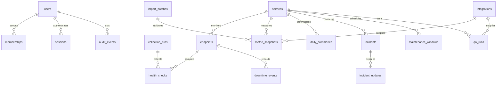

# Lean PostgreSQL schema and ERD

Phase 01 implemented users, memberships, sessions, services, endpoints, audit events and schema_migrations. Phase 02 adds collection_runs, health_checks, downtime_events, daily_summaries and basic maintenance_windows. See [native setup](local-development.md) and [versioned SQL](../../database/migrations/). The full roadmap below includes future tables. Seventeen application tables are proposed: the ten requested core domains and seven justified support tables. A migrator may own one additional metadata table. Only001/002 belong to Phase 01;003 is the Phase 02 upgrade. UUID keys, UTC timestamptz, finite numeric values, explicit constraints and parameterized SQL. Environment is a constrained value on scoped rows, not a separate deployment service.

| Table | Purpose and main fields/constraints |
| --- | --- |
| users | issuer+subject unique, display email, approval/disabled timestamps. No local password or provider keys |
| memberships | user_id+environment unique, role enum admin/operator/viewer. Simple environment-scoped staff roles; no separate role/publisher tables |
| sessions | unique hashed token, user, issued/last_seen/expires/revoked times; 30m idle/8h absolute proposal. Standard library may require narrowly justified OIDC metadata |
| services | name/product label, environment, owner, provider/resource references, criticality, verification/evidence, revision; unique approved name+environment |
| endpoints | service_id+environment composite FK, approved canonical HTTPS URL, expected codes, required flag, enabled/disabled times, approver, revision. Fixed 900s cadence in v1 |
| health_checks | endpoint/env/run/slot, observed_at, collected_at, ingested_at, outcome success/failure/unknown, HTTP code nullable, latency nullable, attempts<=2, safe error code; unique endpoint+scheduled_slot |
| metric_snapshots | service/env, integration nullable, metric/name/unit/aggregation, bounded dimensions, finite value, observed/collected/ingested timestamps, quality, source_method provider_api/manual/csv, source_reference, actor/batch nullable, supersedes ID/reason. Source-method consistency checks and deterministic source observation key unique |
| daily_summaries | service/env, UTC day, method version, check counts and coverage, bounded metric aggregates separated by source_method, watermark; unique service+day+method. Approved max metric names/dimensions prevent JSONB growth |
| integrations | provider/env, approved resources/metrics, secret reference, mode disabled/api/webhook/manual, permission/cost review evidence+expiry, budget units/counters, last success/error. Default disabled; enabled API requires current verified_no_incremental_cost and explicit permission approval |
| incidents | service nullable for general operations, environment, title/severity, lifecycle, owner, started/resolved time, revision. One service per incident in MVP; multi-service graph deferred |
| qa_runs | service/env, integration nullable for manual, source_run_id, source_event_id/digest, suite, timestamps/duration/status/counts, bounded summaries/evidence/security references, source_method and actor. Unique integration+source_run_id and integration+event_id; manual uniqueness scoped to source_reference+service+env+run ID |
| audit_events | actor/service identity, environment nullable for global login/admin events, action, target, time, safe reason/digest/request ID. Runtime insert-only, no raw payload/secret |
| collection_runs | deployment environment+scheduled_slot unique, started/finished/status, counts/usage/runtime/safe error. Simple overlap/invocation evidence, not a queue or lease scheduler |
| downtime_events | endpoint/env, first failure/confirmation/first recovery/resolved timestamps, evidence-gap flag, open/closed. At most one open event per endpoint via partial unique index; sampled observations, not exact outage duration |
| incident_updates | incident/env FK, status/time/message/actor; append-only narrative, optimistic parent revision |
| maintenance_windows | service/env, start<end, approved actor, reason, revision. Service-wide endpoints; no publication record. Overlaps merged when excluding slots |
| import_batches | actor/env, source reference, body/normalized digest, idempotency key, counts, created_at; unique actor+env+key and batch digest with documented replay handling. Bounded validated rows stored in observations, not arbitrary uploaded files |

The table above contains **17 tables**: the lean model uses 10 requested core tables plus 7 support tables (memberships, sessions, collection_runs, downtime_events, incident_updates, maintenance_windows, import_batches). Migration history is a tool-owned eighteenth metadata table if required by the selected migrator, not an application domain. This accounting prevents silently expanding the model.

## Integrity and access

Every service-bound child has an `(id,environment)` parent key/FK so a staging row cannot point to production. Actor membership is still checked server-side; FKs do not replace authorization. Only system collectors assign provider_api and automatic check provenance. Manual source identity never impersonates a provider integration. Metric descriptor/unit rules live in reviewed typed configuration rather than multiple capability/definition/series tables.

Deduplication: endpoint+slot for probes; integration+resource+metric+observed_at+aggregation+dimensions hash for provider readings; deterministic manual observation key plus import identity for staff inputs. Identical retries return existing data. Conflicting same-source observations need explicit correction/supersedes reason; no silent overwrite. QA terminal run conflicts return 409. Atomic audit accompanies staff mutations and imports. Primary entity creation supports a scoped request key/digest on that entity where required; no generic background request queue.

Collection uses one session advisory lock on a dedicated connection, not transaction-pooled session assumptions. Unique run/observation keys remain a second defense. No lease/fencing orchestration, outbox, public schema, alert-delivery tables, report artifacts, hourly rollups or arbitrary JSON provider payloads.

## Modest storage and indexes

Proposed envelope, not verified inventory: 20 endpoints ×96/day ×30d = **57,600 health checks**. Up to 100 metric series ×96/day ×30d = **288,000 snapshots**. At an illustrative 500 bytes/row including indexes, combined ~173 MB before other tables, WAL/backups and bloat; measure real row sizes and free storage before release. Daily per-service summaries: 20×365=7,300/year. No partitions or extra time-series engine unless observed workload justifies an ADR.

Indexes: health_checks(endpoint_id,scheduled_slot DESC); metric_snapshots(service_id,metric_name,observed_at DESC); daily_summaries(service_id,day); incidents(environment,status,started_at); qa_runs(service_id,completed_at DESC); audit_events(occurred_at); plus PK/unique/FK support justified by query plans. Avoid generic JSONB GIN indexes. Connection budgets initially web pool<=5, job<=2 (one dedicated lock), migration<=1, reserve capacity against actual small-plan limits; validate real plan constraints.

## Retention, migrations and restore

Raw checks/metrics 30d; daily summaries 12m; QA/incidents/downtime/maintenance/audit 12m proposal; import metadata 90d; run records 30d; sessions expiry+7d. Roll up and verify counts before bounded deletes; no unbounded purge or partitions. Preserve actor/source on snapshots when batch metadata ages out, and retain batches referenced by still-retained records or detach only their redundant link under documented retention policy. Security/privacy owner approves retention/holds.

Recompute affected retained dates after valid corrections. Post-30d raw periods remain immutable summarized evidence unless explicitly reviewed; do not invent missing detail. Forward reviewed migrations with separate credential and rollback-compatible releases; test local upgrade/restore. Managed backup retention and temporary restore proof are in deployment/runbooks. No archive storage is assumed.

Migrations 001 and 002 run under one transaction and an advisory lock. The runner records each SQL file digest and refuses changed applied migrations. Role names derive from the validated database tier. The web identity can read users/memberships, manage opaque sessions, read/write services and append audits. Endpoint activation requires exact offline approval, enforced in 003. The database owner manages memberships through the offline command. Identity and membership changes invalidate sessions. Repeated service creates/edits use an actor-scoped unique audit key with a request digest and original response. The application enforces optimistic versions and immutable environment. Monitoring tables in 003 are implemented; metrics, QA, import and incident domains remain future work.

## Migration 003 — monitoring

Endpoints gain revisioned configuration, exact approval evidence, enablement/required intervals, current calculated state and latest observation. SQL limits confirmation thresholds2–5 and latency thresholds; scope is immutable, URL changes invalidate approval, and configuration changes reset pending streaks. Composite endpoint/environment FKs protect checks, daily summaries and downtime. A service/environment FK protects maintenance. Unique deployment-tier/quarter-hour slots and endpoint/slot primary keys prevent duplicate observations; a partial unique index permits at most one open outage per endpoint. UTC observation, collection and ingestion timestamps are distinct.

Daily summaries are per endpoint/day with96 compact S/F/U/M/N values and a watermark, rather than the earlier proposed service-only count row. This retains historical endpoint enablement/required membership and lets service reads derive one worst-required-endpoint sample per instant and exact partial-day rolling windows. It is still one small table with no time-series engine. Response bodies, tokens and unbounded payloads are not stored. Historical required flags live in enablement periods. The summary method is version1.

Web may read monitoring evidence and mutate only approved configuration columns; it cannot write approvals, state, checks, summaries or run rows. Collector may read targets, write observations/state/events/runs/summaries and run bounded retention; it cannot change targets, approval or staff access. Migrator remains offline. The monitor_samples SQL function is security-invoker and not public. All connections use the existing local-tier guards.

See [retention, migration recovery and commands](../operations/availability-monitoring.md). SQL rollback and native restore are tested on disposable data. No destructive down migration is supplied because it would erase evidence. Earlier migration checksums remain unchanged.

## Phase 03 implementation

Migration 004 implements integrations, metric_snapshots and import_batches. Four small supporting tables enforce canonical units, per-resource capabilities, transaction-safe read budgets and daily metric retention. Checked insertion views split web and collector provenance. The previous proposed table count is historical. See [ADR 0009](../decisions/0009-infrastructure-metrics.md) and [retention commands](../operations/infrastructure-health.md).

## Migration 005 — operations

Composite service/environment keys protect QA runs, incidents and existing maintenance. A source/run uniqueness constraint and source/event aliases with raw digests distinguish replay from conflicts. The staff actor is required only for manual QA. Incident updates are keyed by incident and revision; web grants allow insertion, not UPDATE or DELETE of history. Future maintenance edits lock per service, reject overlap and retain cancellation. Existing availability reads ignore cancelled windows.

The collector-only bounded retention function removes up to 250 QA runs, 100 resolved incidents and 100 expired windows older than 367 days per maintenance invocation; delivery aliases and incident notes expire with their parent. Open incidents remain. Earlier monitoring and metric retention rules still apply. No production database was accessed.
