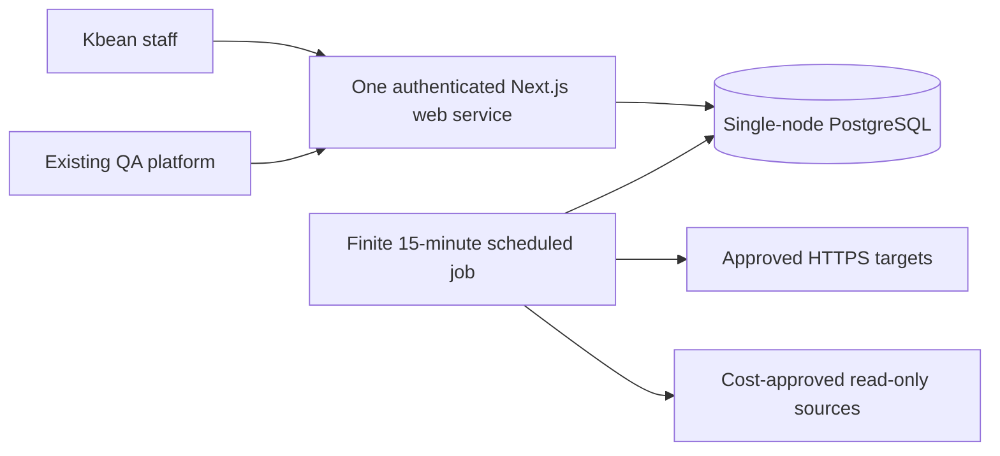

# Kbean Health System — Revised Lean Architecture

New direction: Internal monitoring platform, minimal infrastructure, and no additional paid API services.

I agree we should simplify the Phase 00 design before Codex writes any code. The current proposal has too many components for what you want to achieve.

One important correction: the $434/month in Codex's report is an estimated hosting and database budget, not an API bill. It includes separate staging and production infrastructure, monitoring servers, and a high-availability database.

We don't need that setup for the first version.

Our revised priorities are:

- Budget: Target approximately €50/month for DigitalOcean hosting and database, with a hard spending limit to agree before deployment.
- Purpose: An internal dashboard for Kbean staff, not a public SaaS product.
- Monitoring: See whether services are online, how infrastructure is performing, and whether anything needs attention.
- Integrations: Use existing cloud providers' read-only monitoring interfaces where they are available without additional paid features.
- Simplicity: No extra monitoring servers, unnecessary microservices, expensive databases, or paid AI APIs.
- Future expansion: Keep the architecture flexible, but don't build features we don't need yet.

We should retain the important parts of the original plan—security, documentation, proper testing, historical measurements, and incident tracking—while removing the infrastructure overhead.

## 1. The new budget is realistic—with limits

I checked DigitalOcean's current published pricing.

Recommended starting infrastructure

Web application

# $12/mo

1 GiB App Platform

Managed PostgreSQL

# $15/mo

Single node, 1 GiB

Starting base total

# $27/month

Within target

Published USD prices, before taxes, scheduled-job runtime, and optional extras. The €50 ceiling must be checked against the actual account's final bill.&#x20;

[image](https://www.google.com/s2/favicons?domain=https://docs.digitalocean.com\&sz=32)

DigitalOcean Documentation

+1

If the app needs more memory, DigitalOcean currently lists a 2 GiB App Platform plan at $25/month. Together with the $15 database, that becomes $40/month before extras.&#x20;

[image](https://www.google.com/s2/favicons?domain=https://docs.digitalocean.com\&sz=32)

DigitalOcean Documentation

I would start with the 1 GiB application plan, measure its performance, and upgrade only if necessary.

### What we are removing

| Previously planned                                   | New decision                                                        |
| ---------------------------------------------------- | ------------------------------------------------------------------- |
| Separate staging infrastructure running continuously | Develop and test locally; deploy temporary staging only when needed |
| Advanced PostgreSQL with standby                     | Small single-node managed PostgreSQL                                |
| Dedicated monitoring Droplet                         | Remove                                                              |
| Prometheus                                           | Remove for v1                                                       |
| Grafana                                              | Remove for v1                                                       |
| Uptime Kuma server                                   | Remove for v1                                                       |
| Separate always-running worker                       | Replace with a lightweight scheduled job                            |
| Complex metrics collection and time-series pipeline  | Simple database-backed measurements                                 |
| Public status website                                | Private authenticated status page for v1                            |
| Separate report-processing infrastructure            | Generate reports inside the existing application                    |
| Paid AI or external monitoring services              | None                                                                |

We're not removing testing, authentication, access controls, backups, or logging. Those remain essential even for a small internal tool.

## 2. How to collect data without extra API bills

There is one important distinction:

We can avoid paying for third-party API services, but we cannot automatically retrieve every internal cloud metric without some form of integration.

A website availability check is free to implement using ordinary HTTPS requests. However, reading Cosmos DB RU consumption requires access to Azure monitoring data.

Here is what I found.

| Source                  | Low-cost strategy                                          | Phase 1 decision                |
| ----------------------- | ---------------------------------------------------------- | ------------------------------- |
| INSSA websites and APIs | Direct HTTPS health checks                                 | Automatic                       |
| DigitalOcean            | Existing monitoring endpoints and permitted read access    | Automatic where no new charge   |
| Azure Cosmos DB         | Azure Monitor or manual metric snapshots                   | Verify cost before automation   |
| GCP                     | Cloud Monitoring within confirmed free allowance           | Conditional                     |
| Firebase                | Existing supported telemetry, without new BigQuery exports | Conditional                     |
| Existing QA system      | Existing internal API/webhook or simple import             | Integrate without paid services |

Azure: Standard platform metrics are collected without charge, but Microsoft states that retrieving metrics through its REST API incurs a cost. Therefore, we should not automatically poll Azure Monitor until we have approved its billing implications.&#x20;

[image](https://www.google.com/s2/favicons?domain=https://learn.microsoft.com\&sz=32)

Microsoft Learn

GCP: Google currently includes the first one million time series returned by Cloud Monitoring read APIs per billing account each month. Beyond that, charges apply. We can use the free allowance only after checking existing account consumption and establishing a conservative query cap.&#x20;

[image](https://www.google.com/s2/favicons?domain=https://cloud.google.com\&sz=32)

Google Cloud Observability

For strict zero additional API charges, the fallback is simple: show service uptime automatically, and allow authorized users to import selected infrastructure metric snapshots manually until a cost-free automatic method is verified.

This still delivers a functioning health platform. It just means we must label the difference between automatically monitored availability and manually updated infrastructure metrics.

## 3. The revised system architecture

### Kbean Health — Lean MVP

> Editorial note: malformed exported diagram CSS replaced with a logical diagram; supplied prose is retained.

One continuously running web application, one managed database, and a scheduled collection job billed only while running.

DigitalOcean App Platform supports scheduled jobs at a minimum interval of 15 minutes and bills them only while they execute. That is suitable for our first version because we don't require second-by-second monitoring.&#x20;

[image](https://www.google.com/s2/favicons?domain=https://docs.digitalocean.com\&sz=32)

DigitalOcean Documentation

### What the dashboard will do

Overview

One screen showing service availability, active issues, last successful checks, and summary health metrics.

Application status

INSSA Studio, Discovery, Life, and other approved services. Automatic HTTPS checks, response times, uptime history, and downtime events.

Infrastructure health

DigitalOcean metrics and other approved cloud measurements, using free integrations where verified and manually imported snapshots otherwise.

QA and security overview

Latest tests, failures, and security findings from the existing QA platform, without duplicating the testing infrastructure.

Incidents and historical reports

Track problems, downtime, maintenance, previous readings, and daily, weekly, and monthly summaries.

This preserves the original project purpose.

For the first version, the XPR-style service status page will simply be a private page inside the authenticated dashboard. We can make it public later without rebuilding the monitoring foundation.

### A few operational trade-offs

- A 15-minute check interval means short outages may be missed. We must label uptime as sampled availability, not continuous availability.

- Single-node PostgreSQL is cheaper but less resilient. DigitalOcean provides managed backups and point-in-time recovery within its documented seven-day window; restore testing remains necessary.&#x20;

  [image](https://www.google.com/s2/favicons?domain=https://docs.digitalocean.com\&sz=32)

  DigitalOcean Documentation

- DigitalOcean Monitoring is available without an additional service charge, and its supported metrics can be accessed through DigitalOcean interfaces. This makes it our first infrastructure integration.&#x20;

  [image](https://www.google.com/s2/favicons?domain=https://docs.digitalocean.com\&sz=32)

  DigitalOcean Documentation

  +1

- The application still needs HTTPS authentication, access controls, SSRF protections for approved monitoring targets, and secure credential handling.

## 4. Correction instructions for Codex

This is the instruction I would send to Codex in your existing `Health-system-Kb` repository. It explicitly supersedes the expensive Phase 00 infrastructure assumptions without asking Codex to start implementation.

# Kbean Health System — Phase 00 Architecture Revision

## Task: Replace the Overengineered Architecture With a Lean, Cost-Controlled MVP

**Priority:** High\
**Status:** Architecture revision only — no implementation authorized\
**Budget target:** Approximately €50/month maximum for initial DigitalOcean hosting and database, including allowance for small operational charges.

### 1. Context

Phase 00 documentation has been completed, but the proposed architecture is unnecessarily complex and expensive for the project's current operational requirements.

The existing report estimates approximately $434/month for production and staging infrastructure. This is not an acceptable initial deployment baseline.

The project owner has clarified the requirements.

Kbean Health is an **internal operational monitoring platform** intended to provide centralized visibility across Kbean's applications and infrastructure.

The platform must answer:

- Are our applications and APIs online?
- Which services are experiencing downtime or degradation?
- What health metrics are available from our infrastructure providers?
- What are the latest QA test results?
- Are there active incidents or operational problems?
- How healthy have our services been over time?

The system must prioritize simplicity, security, low maintenance, and minimal recurring expenses.

### 2. Mandatory Cost Constraints

The MVP must:

1. Use DigitalOcean for application hosting and PostgreSQL.
2. Target a monthly infrastructure budget of approximately €50 or less, including anticipated small variable charges.
3. Use the smallest practical application and database plans.
4. Avoid separate always-running monitoring servers.
5. Avoid new paid third-party API subscriptions.
6. Avoid OpenAI API calls and all runtime AI inference features.
7. Avoid paid logging, tracing, monitoring, and analytics services.
8. Avoid new billable Azure, GCP, Firebase, or other provider features.
9. Use existing native cloud monitoring capabilities only after confirming their permissions, pricing, and available free usage.
10. Disable integrations by default when their costs are unknown or potentially chargeable.
11. Require explicit approval for any component that increases the approved budget.
12. Document projected spending, usage-based billing risks, and the limits of any budget controls.

Do not treat cost alerts as guaranteed hard billing caps.

### 3. Approved Lean Architecture

Replace the previous multi-service architecture with:

**One DigitalOcean App Platform web service**

- Next.js.
- React.
- TypeScript.
- Tailwind CSS.
- Zod validation.
- Authenticated internal dashboard.
- Built-in REST API.
- Health status pages.
- Incidents and maintenance management.
- Basic charts and historical reports.

**One DigitalOcean Managed PostgreSQL database**

Start with the smallest suitable single-node plan.

Store:

- Users and roles.
- Monitored services and endpoints.
- Health check results.
- Latest available infrastructure snapshots.
- Monitoring freshness and source information.
- Historical daily aggregates.
- QA result summaries.
- Incident records.
- Integration settings.
- Administrative audit events.

**One lightweight scheduled collection job**

Use a DigitalOcean App Platform scheduled job, starting at 15-minute intervals for approved availability checks.

The job should:

- Execute authorized HTTPS health checks.
- Collect approved no-additional-charge monitoring data.
- Store timestamps and results.
- Update service health.
- Generate lightweight daily aggregates.
- Handle failures, timeouts, and retries safely.

Jobs are billed for execution time, so estimate their actual runtime costs.

Do not deploy a separate continuously running worker for the MVP.

### 4. Remove From the MVP

Remove all implementation requirements for:

- Dedicated Uptime Kuma servers.
- Prometheus.
- Grafana.
- Additional monitoring Droplets.
- Redis.
- Kafka.
- Kubernetes.
- Elasticsearch.
- Separate microservices.
- Advanced PostgreSQL clusters.
- High-availability standby database nodes.
- Continuously running production and staging copies.
- Secondary-region monitoring infrastructure.
- Complex distributed job orchestration.
- Paid analytics platforms.
- AI analysis services.
- Paid SMS or third-party notification services.

Preserve these items only as deferred options if they are justified by future requirements.

Do not leave the removed components as hidden dependencies in the deployment plan, pricing model, repository structure, or acceptance criteria.

### 5. Monitoring Requirements

#### Application Availability

Automatically monitor approved Kbean endpoints, including:

- INSSA Studio.
- INSSA Discovery (`inssa.us`).
- INSSA Life.
- Other verified Kbean web services.
- Approved API health endpoints.

Provide:

- Current sampled service status.
- Last check time.
- Last successful check.
- HTTP response status.
- Response latency.
- Historical availability.
- Downtime and recovery records.
- Incident history.
- Scheduled maintenance notices.

Checks should use ordinary HTTPS requests with timeouts and bounded retries.

Implement confirmation logic to reduce false alerts.

Do not mistake skipped checks or collector failures for confirmed downtime.

The first version should use a 15-minute polling interval unless a different interval can be achieved within the approved cost and deployment model.

#### Infrastructure Monitoring

Start with DigitalOcean infrastructure because DigitalOcean Monitoring has no additional service charge.

Collect only verified, supported metrics.

For Azure, GCP, Firebase, Hashio, Fusion, or additional providers:

- Confirm the actual product and resource identities.
- Verify whether monitoring data can be accessed without additional charges.
- Review API limits and existing consumption.
- Use narrowly scoped read-only credentials.
- Disable automatic collection when zero incremental cost cannot be demonstrated.
- Support manual metric snapshot entry or structured CSV imports where appropriate.

A manually imported reading must be identified as such in the interface.

Do not display old or uncollected metrics as live data.

#### QA Integration

Reuse the current Kbean QA platform.

Prefer an existing authenticated API or signed webhook if it does not require a paid service.

Show:

- Latest test runs.
- Passing and failing results.
- Skipped/flaky tests.
- Execution time.
- Test environment.
- Relevant security findings.
- Original report references.

Do not build a second QA runner.

### 6. Internal Dashboard Scope

Create a secure internal application with these primary sections:

1. Overview.
2. Application Status.
3. Infrastructure Health.
4. QA & Security.
5. Incidents & Maintenance.
6. Reports & History.
7. Settings & Integrations.

The service status interface should be modeled on the previously approved XPR Network reference, but access must require authentication in MVP.

No public-facing status publishing, subscriber infrastructure, or public incident notification service is required initially.

Use one coherent, minimal interface with responsive dashboards and concise operational charts.

### 7. Authentication and Security

Use a suitable standard OIDC library with Google sign-in for approved staff.

Retain:

- Server-side RBAC.
- Secure sessions.
- MFA through the identity provider.
- Application audit logging.
- Approved monitoring target allowlists.
- SSRF prevention and safe outbound requests.
- Secret protection.
- Read-only cloud access.
- Environment separation.
- Input validation and API authorization.
- Signed QA webhook verification where applicable.
- Database encryption in transit.
- Automated tests.

Security must not be removed to reduce costs.

However, do not introduce unnecessary paid identity providers or external security products.

### 8. Database Simplification

Revise the existing database model for MVP requirements.

Prefer a small set of clearly related tables, such as:

- users
- services
- endpoints
- health_checks
- metric_snapshots
- daily_summaries
- integrations
- incidents
- qa_runs
- audit_events

Add only justified tables for roles, credentials metadata, migrations, maintenance, and scheduling.

Preserve:

- Source attribution.
- Environment separation.
- Observation and collection timestamps.
- Data freshness.
- Data quality.
- Referential integrity.
- Access control.
- Retention policies.

Avoid unnecessary partitions, complex time-series schemas, and excessive indexes unless actual workload justifies them.

### 9. Reporting

Implement reports using existing PostgreSQL data.

Required:

- Daily system health.
- Weekly availability summary.
- Monthly infrastructure and incident review.
- QA result summary.
- Historical trend charts.
- CSV export.

Do not introduce separate reporting engines, third-party document services, paid APIs, or AI-generated reports.

### 10. Development and Deployment

Use one private GitHub repository.

Keep the TypeScript/pnpm structure simple. Prefer:

- One Next.js application.
- A small collection-job entrypoint.
- Shared validation and database modules.
- Minimal deployment configuration.
- Local PostgreSQL for development and testing.

Use local development as the primary staging/testing environment.

Allow temporary remote staging only when specifically required and approved.

No production resource or account must be created during this planning revision.

### 11. Testing

Retain thorough testing while simplifying the infrastructure.

Required:

- Unit testing.
- Database integration testing.
- API and authorization testing.
- Provider adapter contract testing.
- Playwright functional testing.
- Safe performance testing.
- Dependency and secret scanning.
- Controlled security testing.
- Backup and restore verification.

Revise performance and capacity targets to reflect a modest internal staff workload instead of a large multi-service monitoring platform.

Acceptance criteria must reflect real requirements, not hypothetical scale.

### 12. Documentation to Revise

Review and update all affected Phase 00 documents, especially:

- `README.md`
- `AGENTS.md`
- `GOALS.md`
- `PLANS.md`
- `PROMPTS.md`
- `docs/architecture/phase-00-report.md`
- `docs/architecture/overview.md`
- `docs/architecture/data-flow.md`
- `docs/architecture/deployment.md`
- `docs/architecture/repository-structure.md`
- `docs/architecture/monitoring-model.md`
- `docs/deployment/cost-estimate.md`
- `docs/database/schema.md`
- `docs/api/openapi.yaml`
- `docs/integrations/feasibility-matrix.md`
- `docs/security/threat-model.md`
- `docs/testing/test-strategy.md`
- `harness/build/backlog.md`
- `harness/build/phase-01.md`
- `harness/context/decisions-and-open-questions.md`
- `harness/build-log.md`

Review all other affected ADRs, phase plans, integration designs, and operational documents for contradictions.

Retain the original Phase 00 baseline for traceability and document the new decisions in ADRs.

Do not delete architectural history merely because the plan has changed.

### 13. Required Deliverables

Produce a revised Phase 00 packet containing:

1. Lean MVP architecture diagram.
2. Simplified runtime and repository structure.
3. Revised feature scope.
4. Updated database schema.
5. Revised API contracts.
6. Zero-additional-paid-API integration strategy.
7. Updated security architecture.
8. Revised testing strategy.
9. Updated cost estimate with a €50/month target and clearly identified risks.
10. Implementation roadmap prioritized by the minimum useful features.
11. List of deferred features.
12. Architecture change summary comparing original and revised proposals.
13. Updated Phase 01 implementation plan.
14. Outstanding decisions requiring approval.

### 14. Scope and Permission Boundary

**This task is strictly documentation and architecture revision.**

Do not:

- Implement application functionality.
- Install dependencies.
- Provision DigitalOcean resources.
- Create databases.
- Configure live provider integrations.
- Modify production infrastructure.
- Change cloud permissions.
- Deploy any service.
- Commit or push Git changes without authorization.

Review the new architecture for contradictions, missing requirements, avoidable expenses, and security gaps.

Stop after updating and validating the planning documents.

**Final objective:** A secure, straightforward Kbean internal health dashboard that delivers useful availability and infrastructure visibility without unnecessary hosting components or additional paid API services.

## 5. My recommendation for the next development plan

Once Codex updates the architecture, I would use this shorter delivery sequence:

01

Foundation

Next.js, authentication, PostgreSQL, service inventory, and basic dashboard.

02

Availability monitoring

Automatic HTTPS checks, uptime history, status indicators, and downtime tracking.

03

Infrastructure metrics

DigitalOcean first, followed by verified zero-additional-charge integrations.

04

QA, incidents, and reports

Integrate test results, track incidents, and generate historical summaries.

05

Testing and production deployment

Security verification, performance, restore testing, and controlled DigitalOcean release.

What I would do now: Give Codex the revision instructions above and let it update Phase 00. Do not authorize Phase 01 implementation until the revised monthly budget, integration costs, and hosting configuration have been checked.

The result should be a much smaller platform that still gives you what you need: log in, check which Kbean applications are running, see the health data we can reliably obtain, review QA results, and understand what happened when something failed.

That is a sensible first version. We can add deeper infrastructure monitoring later when there is a clear need and an approved cost.
